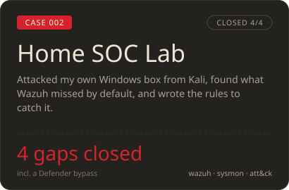
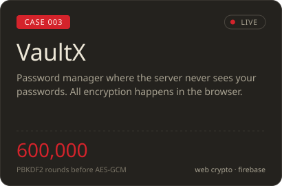
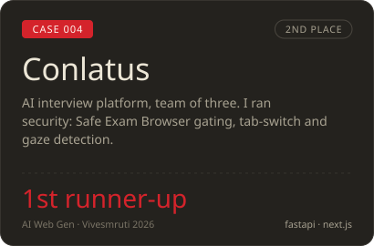

<a href="https://viivek.xyz/"></a>

<p align="center">
  <a href="https://viivek.xyz/"><b>viivek.xyz</b></a> &nbsp;·&nbsp;
  <a href="https://www.linkedin.com/in/viveksharma0502/">linkedin</a> &nbsp;·&nbsp;
  <a href="https://viivek.xyz/Vivek_Sharma_Resume.pdf">resume</a> &nbsp;·&nbsp;
  <a href="https://github.com/VivekSharma0502/gapscan">gapscan</a>
</p>

I got into security by breaking my own projects. Now I build the tools and detections that catch those breaks before someone else finds them.

IT diploma student at N. G. Patel Polytechnic. Looking for a **6-month SOC / security operations / AppSec internship** from **Jan 2027**, remote or on-site.

<br/>

### case files

<p>
  <a href="https://github.com/VivekSharma0502/gapscan"></a>
  <a href="https://github.com/VivekSharma0502/home-soc-lab-wazuh"></a>
  <a href="https://github.com/VivekSharma0502/password-manager"></a>
  <a href="https://viivek.xyz/#writeup-conlatus"></a>
</p>

<sub>full write-ups, written the way an incident is: what was at risk, what I did, what changed → <a href="https://viivek.xyz/#work">viivek.xyz/#work</a></sub>

<br/><br/>

### on my keyboard


<br/>

### right now

```diff
+ finishing CS50's Introduction to Cybersecurity
+ adding MQTT over TLS to my ESP32 monitor
+ shipping GapScan features
- false positives in Wazuh (we're not friends)
```

<br/>

### commit history, but make it 3D


<br/>

<a href="https://viivek.xyz/"></a>
