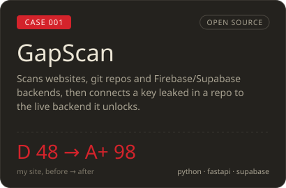
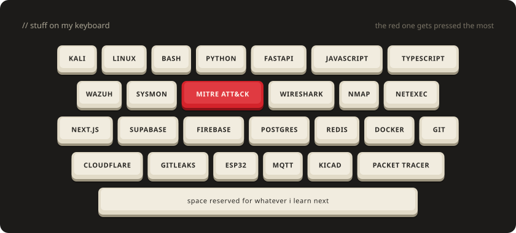
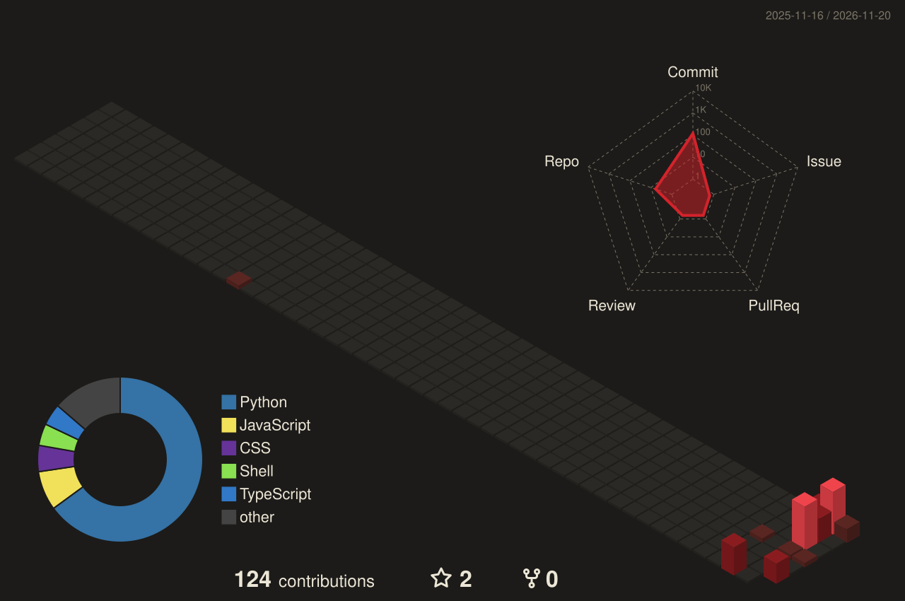

<a href="#"></a>

<p align="center">
  <a href="https://viivek.xyz/">viivek.xyz</a> &nbsp;·&nbsp;
  <a href="https://www.linkedin.com/in/viveksharma0502/">linkedin</a> &nbsp;·&nbsp;
  <a href="https://viivek.xyz/Vivek_Sharma_Resume.pdf">resume</a> &nbsp;·&nbsp;
  <a href="mailto:college0912@gmail.com">college0912@gmail.com</a>
</p>

I got into security by breaking my own projects. Now I build the tools and detections that catch those breaks before someone else finds them.

<br/>

<a href="#"></a>

<br/><br/>

### case files

<p>
  <a href="https://github.com/VivekSharma0502/gapscan"></a>
  <a href="https://github.com/VivekSharma0502/home-soc-lab-wazuh"></a>
  <a href="https://github.com/VivekSharma0502/password-manager"></a>
  <a href="#"></a>
</p>

<sub>click a case to open the repo &nbsp;·&nbsp; live demos: <a href="https://password-manager-beta-one.vercel.app/">vaultx</a> · <a href="https://bookmark-manager-two-xi.vercel.app/">linknest</a></sub>

<br/><br/>

### the log so far

<a href="#"></a>

<br/>

### on my keyboard

<a href="#"></a>

<br/>

### right now

```diff
+ finishing CS50's Introduction to Cybersecurity
+ adding MQTT over TLS to my ESP32 monitor
+ shipping GapScan features
- false positives in Wazuh (we're not friends)
```

<br/>

### commit history, but make it 3D

<a href="#"></a>

<br/>

<a href="#"></a>
